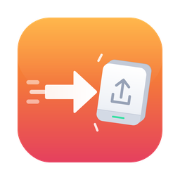

<p align="center"></p>

<h1 align="center">Backeddy for Windows</h1>

<p align="center"><b>A Time Machine for Windows: hourly backups of your files, and any file back as it was on any day.</b><br>
<a href="README.pt-BR.md">Português</a> · <a href="README.es.md">Español</a></p>

<p align="center"><a href="https://github.com/BackEddy/windows/releases"><b>⬇️ Download (Backeddy-Setup-1.0.x.exe)</b></a> · Windows 10 22H2 or 11, 64-bit · free</p>

---

## Before you start: the risks

- **This is version 1.0, the first public one.** It has been tested by very few people. Keep **another copy** of anything you can't lose until it has proven itself.
- It was written with heavy help from AI and reviewed by one person. It's open source: read it, test it, report what breaks.
- The installer **isn't digitally signed yet**, so Windows will say “Windows protected your PC”: **More info › Run anyway**. It's built by GitHub Actions straight from this code.
- Provided as is, without warranty ([MIT License](LICENSE)).

## What it does

- Every hour it backs up **your user folder and your other internal drives** (D:, E:…). Programs and Windows itself are left out — they can be reinstalled. You can uncheck folders you don't need (games, big downloads).
- Open files are copied too (Windows' Volume Shadow Copy).
- Backups go to your home **[Backeddy Server](https://github.com/BackEddy/server)** (found on the network by itself; you just type the server password — the server has to be **another computer**, never this PC) or to an **external drive**.
- **Restore files**: pick a date and time, browse the folders, and bring back a file or a whole folder — beside the current one (a copy with a new name) or in its original place.
- **Versions of a file**: every different version of a file across all backups, newest first; bring back any of them.
- On a laptop it waits when the battery is below 20%, and it waits for the drive or the server to be around.
- Server alerts (a failing disk, for example) show up next to the clock, with “remind me tomorrow / in 3 / in 7 days”.
- English, Português, Español (it follows the Windows language).

## Setting up

1. Download and run `Backeddy-Setup-1.0.x.exe` (see the note about the warning above).
2. Backeddy opens and asks **where backups should go**:
   - **Backeddy Server** — pick your server from the list (or type the address shown on its screen) and type the server password. Needs Backeddy Server **0.9 or newer**.
   - **External drive** — pick the drive. Backeddy creates a `Backeddy` folder on it and shows a **recovery key**: write it down on paper. Without it, nobody can open those backups (they are encrypted) — not even us.
3. That's it. The first backup copies everything and can take hours; the next ones copy only what changed.

A drive that already has Backeddy backups (from this PC before a reinstall, for example) asks for its recovery key and the old backups show up again.

## How much space?

Plan for **twice what you're backing up**: one full copy plus room for history. Backeddy keeps hourly backups for a day, daily for a month, weekly for 3 months, monthly for 2 years and yearly for 5 years (on a Backeddy Server, the server decides).

## Under the hood

C# / .NET 8. A Windows service (`Backeddy`, running as the system) does the work with the open-source **[Kopia](https://kopia.io)** engine (Apache 2.0, included as `kopia.exe`); the app (WinUI 3) is the window and the tray icon, and talks to the service over a local named pipe. Only the Windows user who set Backeddy up can change it. Passwords are kept with Windows' DPAPI, readable only by the service. Logs: `C:\ProgramData\Backeddy\logs`.

## If the PC dies (not yet automatic)

Version 1.0 restores files and versions on the PC that made the backups (also after reinstalling Windows, **if you give the PC the same name**). Bringing everything back on a **new PC** is coming next. Until then, nothing is locked in: an external drive's `Backeddy` folder is a standard [Kopia](https://kopia.io) repository — install KopiaUI on any computer, choose *Local directory*, point it to that folder and use your **recovery key** as the password.

Not yet: games and apps, moving to a new PC, a full system image and a rescue USB drive.

## Building

GitHub Actions builds everything on Windows (`.github/workflows/build.yml`): tests, service, app, Kopia download and the Inno Setup installer. Locally, on Windows with the .NET 8 SDK:

```powershell
dotnet test tests/Backeddy.Core.Tests
dotnet publish src/Backeddy.Service -c Release -r win-x64 --self-contained -o out/service
dotnet publish src/Backeddy.App -c Release -r win-x64 --self-contained -p:Platform=x64 -o out/app
```

Testing guide (in Portuguese): [docs/TESTING.pt-BR.md](docs/TESTING.pt-BR.md).

## Part of Backeddy

[Backeddy for Mac](https://github.com/BackEddy/mac) · [Backeddy Server](https://github.com/BackEddy/server) · MIT © 2026 [Eddy Antonini](https://eddyantonini.com.br)
